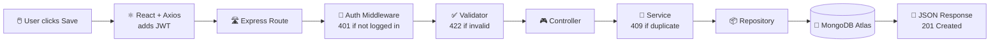
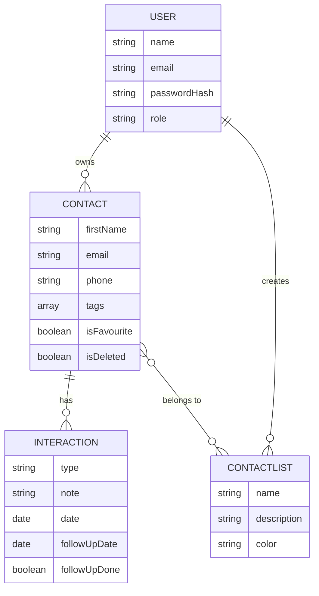

<!-- ============ ANIMATED HEADER ============ -->
<p align="center">
  
</p>

<p align="center">
  <a href="https://github.com/Saihajpreet-Kaur/CardFile">
    
  </a>
</p>

<p align="center">
  
  
  
  
  
  
</p>
<p align="center">
  
  
  
  
</p>

---

## 📇 About the Project

> **Your phone remembers numbers. Cardfile remembers relationships.**

**Cardfile** is a full-stack **MERN** web application to store contacts, log every **call, email and meeting**, set **follow-up dates**, group contacts into **custom lists**, and import or export them as **CSV**, all in one place.

### 😟 The Problem
- 📱 Contacts are scattered across phones, Excel sheets and diaries
- 👯 The same person gets saved again and again (duplicates)
- 🔍 Finding the right contact takes too long
- 🧠 Nobody remembers *what* was discussed last time
- ⏰ Follow-up calls get forgotten, and clients are lost

### ✅ Our Solution
One central platform with **search, history, follow-up reminders, lists and a dashboard** that shows what needs attention today.

---

## ✨ Features

| | Feature | Details |
|:-:|---|---|
| 🔐 | **Secure Login** | JWT authentication, bcrypt password hashing, user / admin roles |
| 👤 | **Contact Management** | Add, edit, delete, restore, with photo, tags and notes |
| 🚫 | **Duplicate Protection** | Same email or phone blocked per user (service check + unique index) |
| 🔎 | **Smart Search** | Debounced search across name, email, phone, company and tags |
| 🎛️ | **Filters & Sorting** | By tag, company, favourite and list; server-side pagination |
| ⭐ | **Favourites & Recent** | Star contacts and see recently viewed ones |
| 🗑️ | **Trash** | Soft delete with restore, or delete forever |
| 📞 | **Interaction Timeline** | Log calls, emails and meetings for every contact |
| ⏰ | **Follow-ups** | Overdue, Today and Upcoming (next 7 days) |
| 🗂️ | **Custom Lists** | Colour-coded groups (many-to-many) |
| 📊 | **Dashboard** | Totals, monthly chart, top tags, next follow-ups (MongoDB aggregation) |
| 📥 | **CSV Import** | Valid rows saved, invalid rows reported with line numbers |
| 📤 | **CSV Export** | Streams the filtered view as a CSV file |
| 🖼️ | **Photo Upload** | Multer + Cloudinary |
| 🛡️ | **Admin Panel** | View users and change roles |

---

## 🛠️ Tech Stack

<p align="center">
  
</p>

| Layer | Technologies |
|---|---|
| 🎨 **Frontend** | React 18 · Vite · React Router v7 · Axios · Tailwind CSS 4 · Lucide icons |
| 🏠 **Home page** | EJS (server-side rendering) |
| ⚙️ **Backend** | Node.js · Express 5 (ES modules) · REST API |
| 🗄️ **Database** | MongoDB Atlas · Mongoose 9 |
| 🔐 **Security** | JWT · bcryptjs · Helmet · CORS · express-rate-limit · express-validator |
| 📁 **Files** | Multer · Cloudinary · csv-parse · @json2csv/node |
| ⚡ **Performance** | Dashboard cache (in-memory, or Redis when `REDIS_URL` is set) |
| 📝 **Logging** | Winston · Morgan · Node.js EventEmitter |
| 🧪 **Testing** | node:test · Supertest · mongodb-memory-server · Postman · ESLint |
| 🚀 **CI / Hosting** | GitHub Actions · Render · Vercel |

---

## 🔄 How a Request Works



**Layers:** `Route → Middleware → Controller → Service → Repository → Model → MongoDB`

---

## 🗄️ Database Design



- 🔑 **Compound unique indexes:** `{ userId, email }` and `{ userId, phone }` (empty values ignored)
- ⚡ **Query indexes:** list by date or name, filter by tag or list, recently viewed, follow-ups
- 🔗 **Referencing:** contacts store an array of list IDs (many-to-many)
- 📊 **Aggregation:** `$facet`, `$group`, `$unwind`, `$lookup` for the dashboard
- 🪝 **Middleware:** tags cleaned before save; interactions deleted along with their contact

---

## 🚀 Getting Started

### 📋 Prerequisites
- Node.js **20.11+** and npm
- A free **MongoDB Atlas** cluster *(optional: use `npm run dev:local` instead)*
- A free **Cloudinary** account *(optional, for photos)*

### ⚡ Quick Start (no database account needed)

```bash
git clone https://github.com/Saihajpreet-Kaur/CardFile.git
cd CardFile
npm install
cp .env.example .env        # then set JWT_SECRET to a long random string
npm run build               # builds the React app
npm run dev:local           # local MongoDB + API + demo data
```

🌐 Open **http://localhost:5000** (home page) and **http://localhost:5000/app** (React app)

### ☁️ With MongoDB Atlas

1. Create a cluster, a database user, and allow your IP in **Network Access**.
2. Put the connection string in `.env` as `MONGO_URI` (for example `.../crm-dev`).
3. Run:

```bash
npm run dev           # API on http://localhost:5000
npm run client:dev    # React with hot reload on http://localhost:5173/app/
```

> ⚠️ `npm run seed` **deletes all data** in the database before adding demo data. Never run it on real data.

<details>
<summary>🔑 <b>Environment variables</b> (click to expand)</summary>

| Variable | Purpose |
|---|---|
| `PORT` | Server port (default 5000) |
| `MONGO_URI` | MongoDB Atlas connection string |
| `JWT_SECRET` | Secret key used to sign tokens |
| `JWT_EXPIRES_IN` | Token lifetime (default `1d`) |
| `CLIENT_URL` | React app origin allowed by CORS |
| `REDIS_URL` | Optional Redis cache |
| `CLOUDINARY_CLOUD_NAME` / `_API_KEY` / `_API_SECRET` | Photo storage |
| `MAX_CSV_SIZE_MB` / `MAX_IMAGE_SIZE_MB` / `MAX_IMPORT_ROWS` | Upload limits |

🔒 Never commit `.env`. Only `.env.example` goes to GitHub.
</details>

<details>
<summary>👥 <b>Demo accounts</b> (local development only)</summary>

| Role | Email | Password |
|---|---|---|
| 🛡️ Admin | `admin@crm.test` | `Admin@1234` |
| 👤 User | `demo@crm.test` | `Demo@1234` |
</details>

---

## 📜 Scripts

| Command | What it does |
|---|---|
| `npm run dev` | ▶️ API with auto-restart |
| `npm run dev:local` | 💻 Local MongoDB + API + demo data |
| `npm run client:dev` | ⚛️ React dev server (Vite) |
| `npm run build` | 📦 Build the React app |
| `npm start` | 🚀 Production start |
| `npm run seed` | 🌱 Reset the database with demo data |
| `npm test` | 🧪 Run 32 API tests |
| `npm run explain` | 🔍 Show index usage (IXSCAN vs COLLSCAN) |
| `npm run lint` | 🧹 Check code with ESLint |

---

## 📡 API Endpoints

<details>
<summary><b>View all 30 endpoints</b> (click to expand)</summary>

| Method | Endpoint | Description |
|---|---|---|
| `GET` | `/api/health` | Health check |
| `POST` | `/api/auth/register` | Create account |
| `POST` | `/api/auth/login` | Sign in |
| `GET` | `/api/auth/me` | Current user |
| `GET` | `/api/contacts` | List with search, filters, sort, pages |
| `POST` | `/api/contacts` | Add contact |
| `GET` | `/api/contacts/recent` | Recently viewed |
| `GET` | `/api/contacts/tags` | Tags with counts |
| `GET` | `/api/contacts/export` | Export CSV |
| `POST` | `/api/contacts/import` | Import CSV |
| `GET` | `/api/contacts/:id` | One contact |
| `PUT` | `/api/contacts/:id` | Update contact |
| `DELETE` | `/api/contacts/:id` | Move to trash |
| `PATCH` | `/api/contacts/:id/favourite` | Toggle favourite |
| `PATCH` | `/api/contacts/:id/restore` | Restore from trash |
| `DELETE` | `/api/contacts/:id/permanent` | Delete forever |
| `POST` | `/api/contacts/:id/photo` | Upload photo |
| `GET` | `/api/contacts/:id/interactions` | Interaction timeline |
| `POST` | `/api/contacts/:id/interactions` | Log call / email / meeting |
| `DELETE` | `/api/contacts/:id/interactions/:interactionId` | Delete interaction |
| `PATCH` | `/api/contacts/:id/interactions/:interactionId/follow-up` | Mark follow-up done |
| `GET` | `/api/followups` | Pending follow-ups |
| `GET` | `/api/lists` | All lists |
| `POST` | `/api/lists` | Create list |
| `PUT` | `/api/lists/:id` | Update list |
| `DELETE` | `/api/lists/:id` | Delete list |
| `PATCH` | `/api/lists/:id/contacts` | Add / remove contacts |
| `GET` | `/api/dashboard/summary` | Dashboard statistics |
| `GET` | `/api/users` | All users (admin) |
| `PATCH` | `/api/users/:id/role` | Change role (admin) |

</details>

---

## 📂 Project Structure

```
📦 CardFile
 ┣ 📂 src                  ⚙️ Express API
 ┃ ┣ 📂 config             MongoDB connection & env settings
 ┃ ┣ 📂 models             User, Contact, Interaction, ContactList
 ┃ ┣ 📂 routes             API URLs
 ┃ ┣ 📂 middlewares        auth, validate, upload, errors
 ┃ ┣ 📂 controllers        request → response
 ┃ ┣ 📂 services           business rules, CSV, cache, storage
 ┃ ┣ 📂 repositories       database queries
 ┃ ┣ 📂 validators         input rules
 ┃ ┣ 📂 events             activity events
 ┃ ┗ 📂 utils              logger, errors, helpers
 ┣ 📂 client               ⚛️ React app (Vite)
 ┃ ┗ 📂 src
 ┃   ┣ 📂 api              Axios + interceptors
 ┃   ┣ 📂 context          Auth & Toast context
 ┃   ┣ 📂 hooks            useApi, useDebounce, ...
 ┃   ┣ 📂 components       Layout, forms, UI
 ┃   ┗ 📂 pages            Dashboard, Contacts, Lists, ...
 ┣ 📂 views                🏠 EJS home page
 ┣ 📂 public               home page scripts
 ┣ 📂 tests                🧪 32 API tests
 ┣ 📂 scripts              seed, local DB, query demo
 ┣ 📂 postman              📮 API collection
 ┣ 📂 samples              sample CSV
 ┣ 📂 .github/workflows    🤖 CI
 ┗ 📜 render.yaml          🚀 deployment config
```

---

## 🧪 Testing

```bash
npm test
```

✅ **32 automated tests**, run against an in-memory MongoDB, so real data is never touched. They cover:

`🔐 Auth` · `👤 Contacts` · `🚫 Duplicates (409)` · `📄 Pagination` · `🔎 Search` · `🗂️ Lists` · `⏰ Follow-ups` · `📊 Dashboard cache` · `📥 CSV import/export` · `🛡️ Admin (403)`

📮 **Postman:** import `postman/CRM.postman_collection.json` (37 requests).

---

## 🔒 Security

| | Protection | Stops |
|:-:|---|---|
| 🔑 | bcrypt hashing | Password leaks |
| 🎫 | JWT | Access without login |
| 🛡️ | Role check | Normal users doing admin work |
| 👤 | `userId` on every query | Seeing another user's data |
| ✅ | express-validator | Invalid data |
| ⏱️ | Rate limiting | Password guessing |
| 🪖 | Helmet | Some browser attacks |
| 🌐 | CORS allow-list | Other websites calling the API |
| 📄 | CSV formula escaping | CSV injection in Excel |

---

## 🔮 Future Scope

- 📧 Email / SMS follow-up reminders
- 👥 Team workspaces with shared contacts
- 🔍 Typo-tolerant search (MongoDB Atlas Search)
- 📅 Google Calendar / Outlook sync
- 📱 Mobile app / PWA

---

### 🎓 Guided by
**Ms. Anu Thind** & **Mr. Abhay Ashish**
Department of Computer Science and Engineering, **Chitkara University, Punjab**

---

<p align="center">
  
</p>

<p align="center">Made with ❤️ for <b>Back End Engineering-II</b></p>
